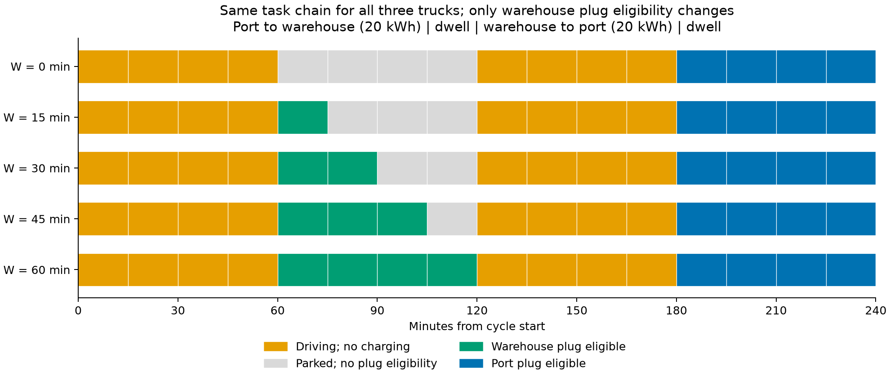
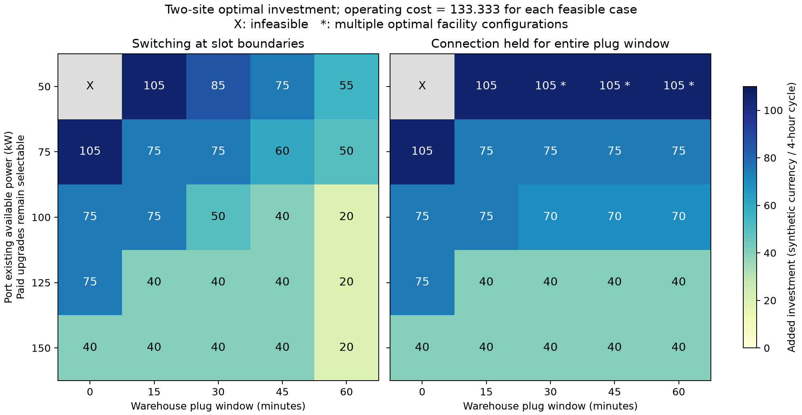

# 港区已有功率×仓库补能窗口：协同补能的适用边界

**本轮正式运行，2026-11-10。** 源码`a520cac2ea26dd237d4c6cccd32c0518cb8247f7`，运行时干净；222测试、100情景、3150设施枚举、100任务审计、310性质比较、4个历史重叠点和原六情景回归通过。采用Ye 2024问题/投资框架的本项目改编，不声称论文原式或原案例复现。

起始分支与实时远程均为`3a618b6`，工作树干净；上轮149测试/54情景/840组合仅先核对历史证据，未冒充本轮新运行。本次按用户范围完成确定性边界实验，没有同时执行固定设施压力测试或不确定性规划。

## 项目问题、输入和决策

问题：在相同港口运输任务和服务要求下，港区—仓库协同充电何时减少设施与运营总费，何时仍受接口、补能窗口或供电容量限制？

输入：三车固定闭合任务、位置/能耗、实际到离站、可插枪资格、初末电量、设备功率、两站原有接口/供电能力、离散扩容选项和合成费用。决定：每站新增接口整数、至多一个付费扩容档位，以及逐车逐槽的连接、充电功率与连续电量。路线、任务归属/顺序、站点启用范围不是优化变量。

两站原有各1接口，仓库原有75kW；既有设施是沉没成本，没有开站费。因此“仓库值得配置”在此指**开放使用既有仓库并按需增接口/扩容**，不代表新建完整仓库充电站的经济评价。停用仓库的75kW/1接口仅是物理存量，不能计入仅港区方案的可用供电。

## 同一任务链与受控窗口



图中五行是五个窗口条件，不是五辆车。三车均0–60分钟港区→仓库、每车耗20kWh；60–120分钟仓库停车；120–180分钟返回港区、再耗20kWh；180–240分钟港区停车可插枪。每车初始100kWh、末值至少100kWh且上界100，效率0.9、单车功率50kW。15分钟驾驶槽能耗均分，无在途充电。

- 港区**已有**可用功率H=50/75/100/125/150kW。原付费增量+50kW（费35）或+75kW（费65）保留，扩容后容量=H+所选增量。
- 仓库窗口W=0/15/30/45/60分钟，资格严格为[60,60+W)，实际停车始终为[60,120)。W=0也不删停车、任务或耗能。仓库仍可付费+25kW（费10）。
- 港区/仓库每新增接口费用分别20/30，各最多新增2个。费用均为同一四小时周期的**合成等效货币**，不是一次性CAPEX、年费或真实报价。
- 每格比较仅港区和两地，分别采用槽边界零耗时换枪/挪车与整窗固定连接。同一次收益比较始终同政策。固定连接锁定整个连续可插枪窗口，功率可为0；不等于实际正换枪耗时模型。

原两个算例配置SHA未变。本轮B01–B04审计将真实运输事件保持与资格窗口变化分开检查，100份输入共19,800项审计均通过。

## 实际费用、可行性和设施结果

全队电池侧需求120kWh，电网购电量恒为$120/0.9=400/3$kWh，电价均1。**每个可行方案运营费均133.333；下表为新增投资费，总费=表值+133.333。** X为不可行，不能当作零费用。

仅港区在两个政策、所有仓库窗口下均为：

| 港区已有功率/kW | 50 | 75 | 100 | 125 | 150 |
|---|---:|---:|---:|---:|---:|
| 投资费 | X | 105 | 75 | 75 | 40 |
| 港区总接口 | — | 3 | 3 | 3 | 3 |
| 付费新增功率/kW | — | 75 | 50 | 50 | 0 |
| 扩容后港区容量/kW | — | 150 | 150 | 175 | 150 |

两地联合投资结果：

| 连接政策 | 港区已有功率/kW | W=0 | W=15 | W=30 | W=45 | W=60分钟 |
|---|---:|---:|---:|---:|---:|---:|
| 槽边界换枪 | 50 | X | 105 | 85 | 75 | 55 |
| 槽边界换枪 | 75 | 105 | 75 | 75 | 60 | 50 |
| 槽边界换枪 | 100 | 75 | 75 | 50 | 40 | 20 |
| 槽边界换枪 | 125 | 75 | 40 | 40 | 40 | 20 |
| 槽边界换枪 | 150 | 40 | 40 | 40 | 40 | 20 |
| 整窗固定连接 | 50 | X | 105 | 105* | 105* | 105* |
| 整窗固定连接 | 75 | 105 | 75 | 75 | 75 | 75 |
| 整窗固定连接 | 100 | 75 | 75 | 70 | 70 | 70 |
| 整窗固定连接 | 125 | 75 | 40 | 40 | 40 | 40 |
| 整窗固定连接 | 150 | 40 | 40 | 40 | 40 | 40 |

星号有两套并列最优硬件：①港区新增2接口、付费+50kW，仓库新增1接口；②港区新增2接口、付费+75kW，仓库不新增。两方案投资均105。全部最优硬件都保存在[metrics.json](metrics.json)的`enumeration_best_hardware`与`optimal_facilities`，后者分别列原有/新增/总接口、原有/新增/总容量及费用分项。单套最优硬件也不意味着运营调度唯一。



50组同政策范围对照的分类如下；这是预设合成网格的计数，**不是现实出现概率**：

| 政策 | 总费降低 | 零收益 | 协同恢复可行性 | 两范围均无解 |
|---|---:|---:|---:|---:|
| 槽边界换枪 | 12 | 8 | 4 | 1 |
| 整窗固定连接 | 11 | 9 | 4 | 1 |
| 合计 | 23 | 17 | 8 | 2 |

仅港区无解而两地可行时记为“恢复可行性”，费用差为null，不计算无限节约。所有100行情景及目标/界限/gap见[CSV](metrics.csv)，配对结果见[scope_comparisons](scope_comparisons.json)。

## 为什么变化：三个可核验机制

**1．接入功率不足时，仓库可以恢复服务可行性。** H=50、W=0时，港区即使选择最大+75档也只有125kW，一小时最多购电125kWh，小于所需133.333。两个范围都无解。W≥15时，仓库已有接口可以提供额外能量，两个政策的两地方案均可行。这不是通过修改初始电量或任务制造收益。

**2．补能窗口缩短后，供电瓶颈可以转移到仓库。** H=75、W=45、允许换枪时，最优为港/仓各2个总接口，港区容量75、仓库付费+25后容量100kW，投资20+30+10=60，总费193.333。若两站都不扩容，购电上界为$75\times1+75\times0.75=131.25<133.333$，单增接口不能修补这一功率×时间缺口。

从该格已完成枚举中筛选“不准仓库扩容”的组合，最佳投资75（港区新增2接口并付费+50），总费208.333。允许仓库+25档使总费少15。因而上轮60分钟下“仓库多25kW零收益”只在对应窗口成立，不能推广到45分钟。[枚举证据摘要](mechanisms.json)

**3．总能量看似充足，仍可能被接口可占用时段限制。** 固定港区2接口/100kW、仓库1接口/75kW、W=45分钟，汇总上界$100+50\times0.75=137.5>133.333$，但完整枚举仍判不可行。港区只有$2\times4=8$个接口槽；仓库只有3个接口槽。每车共需44.444kWh，每个15分钟接口槽最多12.5kWh。仓库到站时电池只有20kWh可用空间，因此每车在仓库最多购入20/0.9=22.222kWh；即使用满3个仓库槽，港区仍至少需要2槽。仓库充0/1/至少2槽的车辆，港区至少还需4/3/2槽；仓库3槽最多将港区总需求12槽降到9槽，仍超过8。W=60提供第4个仓库接口槽后，同一硬件可行；这是已枚举组合的核对，不是另开的压力测试。

在H=100的最优规划中，W=30/45/60对应港/仓总接口分别(2,2)/(3,1)/(2,1)，投资50/40/20。费用随窗口改善，但单类接口数不必单调减少。H=150且整窗固定连接时，每车最终都必须在港区补电，3个港口接口无法减少，接入扩容本已为0，因此所有仓库窗口均无费用优势；某个最优调度使用仓库并不证明经济收益。

## 性质检查与解释范围

310对检查全部通过：仅港区窗口不变40、零窗口范围等价10、已有功率非减不变差80、窗口延长不变差80、两地不劣于仅港区50、换枪不劣于整窗50。保留不可行→可行和平台区间。

整窗窗口单调在本例三车共同到站/共同延长下成立：延续原连接，新增尾部功率置0即可，不增加原连接集合。异质错峰窗口可能新增接口重叠，不能把此结论写成所有整窗模型的一般定理。各方案费用非增也不保证**协同费用差**单调：W=15时，H=75/100/125/150的费用降低分别30/0/35/0，原因是离散扩容阈值。

本轮观察支持既有仓库条件价值、接口与功率×窗口的瓶颈区分、不同设施组合之间的替代，以及不改善费用的边界。尚不能推广为真实港口节约率、建站投资决策、一般时间收敛、实际挪车/排队表现或配电网可行性。峰值只是某个费用最优调度的观测值，未被最小化。模型没有独立任意站点离站目标输入；给定后续任务通过连续电量、固定耗能和下界检验。没有新增换电、V2G、储能、市场、多智能体或RL。

## 公式、代码与正式验证

| 内容 | 数学/检查含义 | 实现入口 |
|---|---|---|
| 目标 | 新增接口费＋扩容费＋$\sum\pi p\Delta t$ | `src/um_charging/model.py::solve` |
| C01、C04 | 整数接口、互斥扩容；$\sum_v a_{vjt}\le N_j^0+n_j$ | `model.py::solve`；`validation.py::check_solution` |
| C02、C03 | 在场/资格、单车互斥；$0\le p\le Pa$ | 同上；时间链由`_validate_timeline`核查 |
| C05 | $\sum_v p_{vjt}\le H_{jt}x_j+\sum_m\Delta H_{jm}u_{jm}$ | 同上；H为本轮已有功率自变量 |
| C06、C07 | $e_{t+1}=e_t+\eta\Delta t\sum_jp-d_t$，电量界与初末恢复 | 同上，检查器从初值独立积分 |
| C08 | 整次连续资格窗口的占用不变 | 同上，仅`fixed_dwell_connection`应用 |
| B01–B04 | 任务保持、资格精确、设备/成本只准声明变化 | `boundary.py::audit_boundary_case`，不调用生成器 |
| 有限硬件/性质 | 逐组合运营最优、全部并列最优、310对不变量 | `investment_experiment.py::enumerate_facilities`；`boundary_validation.py::check_boundary_properties` |

详细入口链接见[公式代码对应](../../docs/model/IMPLEMENTATION_MAP.md)。正式结果：88联合最优、12联合无解；957枚举最优、2193枚举无解。原六回归三最优三无解，4个历史重叠点状态/目标相同。

1048个可行原始解的497,502项独立约束/费用检查通过，最大残差2.5264e-13，容差1e-7。联合最大gap3.5776e-16，枚举最大gap2.1317e-16；保留浮点级非零。没有超时或未解决组合。无解没有原始可行解可检查，不计作检查通过。枚举与联合使用相同运营模型/HiGHS，另以解析界限和不变量交叉核对，不冒称第二个独立求解器证明。

## 可复制的Windows复现

在本研究工作树根目录、干净工作树下运行。当前UM工作区可复用上轮同一解释器；其他机器先用Python3.12安装`requirements-milp.txt`，替换`$python`为相应解释器路径。完整记录目录从已有机器配置读取，不初始化新系统：

```powershell
$python = Join-Path (Split-Path $PWD.Path -Parent) 'truck_charging_v1\.venv\Scripts\python.exe'
if (-not (Test-Path -LiteralPath $python)) { throw '请将 $python 设置为安装 requirements-milp.txt 的 Python 3.12 解释器' }
$env:PYTHONPATH = Join-Path $PWD.Path 'src'
$records = Get-Content .um-records.local.json -Raw | ConvertFrom-Json
$stamp = Get-Date -Format 'yyyyMMdd_HHmmss'
$output = Join-Path $records.records_root "conversations\0001_records\runs\boundary_rerun_$stamp\artifacts"
& $python -X utf8 -B -m um_charging.boundary_cli --config configs/power_window_study.json --output $output
& $python -X utf8 -B -m pytest -q -p no:cacheprovider tests/test_fixed_facility.py tests/test_cli_paths.py tests/test_investment_input.py tests/test_investment.py tests/test_timegrid_model.py tests/test_timegrid.py tests/test_boundary.py tests/test_boundary_validation.py
```

预期222测试通过；实验退出码0，`$output/completion.json`为`passed=true`、100情景/3150组合/310性质比较。结果在`boundary_summary.json`、`scope_comparisons.json`、`properties.json`；各情景目录保存原始输入、解、独立检查和枚举。运行后按既有[记录流程](../../docs/workflow/CONVERSATIONS.md)登记源码/输入及命令，详细证据只进外部无remote Git。

绘图环境与求解环境分开；使用Matplotlib3.11.2、NumPy2.5.4，执行`python scripts/plot_boundary.py --result-dir results/boundary_20261110`重绘图。图中数值来自本轮实际结果，PNG已目视检查；SVG由同一绘图对象导出。完整源码/配置/环境/运行编号及日志hash见[reproduction](reproduction.json)，精选验证见[validation](validation.json)。

## 能力、协作与下一项任务

本轮加强了确定性设施规划的适用边界、任务/资格审计、瓶颈机制解释和可复现证据链；[能力清单](../../docs/research/CAPABILITIES.md)明确已验证和未实现部分。长期研究、记录、同步与协作规则已合并到现有AGENTS和工作流，未改全局配置。

Claude Code2.1.274在独立worktree接受限定UM文件、工具禁用的实际调用，返回`Not logged in`、exit1、模型输入/输出token均0，**没有完成Claude审查**。已保存[可转交任务书](../../conversations/0001_records/artifacts/CLAUDE_BOUNDARY_REVIEW_20261110.md)，未为登录改变配置。Codex内部独立工作树模块提交与只读审查已完成，不能标为Claude贡献。

下一项只设计、尚未执行：固定H=100下两套设施快照A=(港2/仓1接口，100/75kW，规划投资20)和B=(港3/仓1接口，100/75kW，投资40)。两套硬件分别冻结，均继续采用槽边界零耗时换枪政策，在相同名义任务中仅将V1/V2仓库可插枪起点改为60+δ，δ=0/15/30/45/60分钟，V3保持[60,120)。到离站、任务与电量不变；这是装卸占用/资格延迟，不能叫车辆实际晚到。只重求运营，不重新选择设施，并记录冻结硬件哈希。其后才根据证据决定是否需要共享事前投资、按信息更新运营的情景模型。
