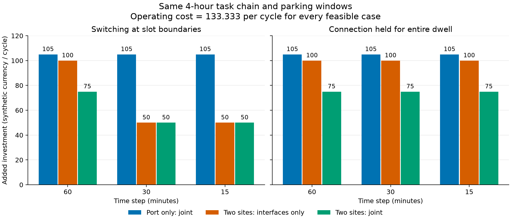

# 同一物理任务链的60／30／15分钟检验

**本轮正式新运行，2026-11-10。** 源码`1c4df03c6a6943ce221e09e05a2bce538de304a7`，运行时干净。延续Ye 2024问题及投资框架的本项目改编，不是论文原式或原案例数字复现。

起始研究分支`codex/investment-milp-20261110`的本地与实时远程提交均为`318bf74a04af3e4e978ee53647aa02c17781c9b1`，工作树干净。上轮投资源码`43e34ca`及102测试/9情景/140组合先核查历史证据；本轮新运行另行登记为`20261110_timegrid_tests`和`20261110_timegrid_suite`。旧106项原型测试没有在本轮重跑。

## 保持什么、改变什么

同一三车、两站、四小时任务链：0–60分钟港区→仓库，每车20 kWh；60–120分钟仓库停靠可插枪；120–180分钟仓库→港区，再耗20 kWh；180–240分钟港区停靠可插枪。所有实际到离站时刻、资格、路线和归属一致，没有新增停车窗口。

每车初始100 kWh、末电量至少100 kWh（上界100）；效率0.9、单车50 kW。两站各有1接口和75 kW可用功率；接口/扩容费用与原配置相同。原投资配置和原固定设施配置SHA均未变。驾驶耗能在子槽内均分，是显式假设；在途边界不是设施，禁止停车充电。54组输入均通过独立物理事件重聚合和设备/费用一致性检查。[物理事件](physical_events.json)、[设计](../../conversations/0001_records/artifacts/TIMEGRID_DESIGN_20261110.md)

本轮比较两种连接政策：

- **槽边界可换枪**：每槽内一接口服务至多一车，边界可拔枪、挪车、重新插枪；耗时、耗能和操作费均设0，假定等待/挪车空间可用。细网格只增加同一停靠内的重分配机会。
- **整窗固定连接**：C08锁定整次连续可插枪窗口的占用，功率可以改变或为0，但不能把接口中途转交另一车。这比“充电不中断”更强，是归因诊断，不是实际换枪耗时模型。

## 投资与费用对照

下面的接口均为**新增数（港区，仓库）**；扩容是新增kW。费用均为同一四小时周期的**合成等效货币**，不是设备购置额、年费或真实成本。

| 连接政策 | 步长/min | 服务与投资权限 | 新增接口 | 扩容（港区，仓库）kW | 投资费 | 运营费 | 总费 |
|---|---:|---|---|---|---:|---:|---:|
| 槽边界可换枪 | 60 | 仅港区，联合投资 | (2,0) | (75,0) | 105 | 133.333 | 238.333 |
| 槽边界可换枪 | 60 | 两地，仅增接口 | (2,2) | (0,0) | 100 | 133.333 | 233.333 |
| 槽边界可换枪 | 60 | 两地，联合投资 | (2,0) | (50,0) | 75 | 133.333 | 208.333 |
| 槽边界可换枪 | 30 | 仅港区，联合投资 | (2,0) | (75,0) | 105 | 133.333 | 238.333 |
| 槽边界可换枪 | 30 | 两地，仅增接口 | (1,1) | (0,0) | 50 | 133.333 | 183.333 |
| 槽边界可换枪 | 30 | 两地，联合投资 | (1,1) | (0,0) | 50 | 133.333 | 183.333 |
| 槽边界可换枪 | 15 | 仅港区，联合投资 | (2,0) | (75,0) | 105 | 133.333 | 238.333 |
| 槽边界可换枪 | 15 | 两地，仅增接口 | (1,1) | (0,0) | 50 | 133.333 | 183.333 |
| 槽边界可换枪 | 15 | 两地，联合投资 | (1,1) | (0,0) | 50 | 133.333 | 183.333 |
| 整窗固定连接 | 60／30／15 | 仅港区，联合投资 | (2,0) | (75,0) | 105 | 133.333 | 238.333 |
| 整窗固定连接 | 60／30／15 | 两地，仅增接口 | (2,2) | (0,0) | 100 | 133.333 | 233.333 |
| 整窗固定连接 | 60／30／15 | 两地，联合投资 | (2,0) | (50,0) | 75 | 133.333 | 208.333 |



每种步长和政策下均保留五类无解：仅港区不投资、仅港区只增接口、仅港区只扩功率、两地不投资、两地只扩功率。第九情景把仓库已有功率75提高到100 kW，联合投资最优值始终不变。全部54行的状态、界限、gap和所有最优设施组合见[JSON](metrics.json)与[CSV](metrics.csv)。图仅画三类可行主对照，无解没有画成零费用。

这五类无解有跨粒度不变的能量上界：仅港区不投资/只扩功率被单接口限制为50 kWh；仅港区只增接口被接入容量限制为75 kWh；两地不投资/只扩功率被两站单接口限制为合计100 kWh。均小于所需400/3 kWh，不能靠细化时间解除。

两地联合方案的费用分解也应区分：60分钟为接口40＋扩容35＝75；细网格为接口20＋30＝50、扩容0。接口费用本身增加10，扩容费用减少35，净减少25；没有证据说明每一项设施投入都减少。

## 变化来自什么约束

全队电池侧需求120 kWh，电网购电量为$120/0.9=400/3$ kWh，故所有可行方案运营费用相同。仓库到站时每车仅有20 kWh电量空间，仓库全队最多购入$200/3$ kWh；不能靠初始电量或过量提前充电制造优势。

**细网格投资50有解析下界。** 若港区不增接口，港区单接口一小时最多供50 kWh，即使仓库补满，合计$50+200/3<400/3$，所以港区至少新增1接口，成本20。若仓库仍仅1接口、港区仍75 kW，两地最多供$50+75=125<400/3$，因此还须仓库新增接口（至少30）或港区扩容（至少35）。总投资至少50；30分钟的可行手工排程和正式联合求解都以两站各增1接口、无扩容达到此界，15分钟也达到。

| 实际时间 | 仓库三车功率 kW | 港区三车功率 kW |
|---|---|---|
| 60–90分钟 | (400/9, 275/9, 0) | (0,0,0) |
| 90–120分钟 | (0, 125/9, 250/9) | (0,0,0) |
| 180–210分钟 | (0,0,0) | (400/9, 0, 275/9) |
| 210–240分钟 | (0,0,0) | (0, 400/9, 275/9) |

该排程只是独立检查通过的解析可行见证，不冒充求解器所选的唯一调度；15分钟把每段重复两次。两站每槽最多2车接入，站点不超过75 kW，单车不超过50 kW，三车最后均回100 kWh。换枪发生在已有停靠内的90、210分钟，行驶/停靠边界不变。

**整窗固定连接使本例粗细网格等价。** 任一细网格解可在原每小时内取功率时间平均，保持投资、固定占用和小时端点电量；线性的设备/站点上界及电费积分仍成立。反向把粗槽功率复制至细槽，均分行驶能耗；驾驶电量单调下降、停靠电量单调上升，原端点有界即可保证新增边界有界。因此本例固定连接下不仅最优费用相同，枚举得到的可行硬件集合也相同。此证明依赖小时内参数恒定、事件边界对齐等条件，不推广到任意实际任务。

**仅港区结果不变。** 一小时需购入$400/3$ kWh，两接口最多100 kWh，故需3个总接口；75+50=125 kW仍不足，必须选择+75档。细化并不解除总能量、单车功率与接入容量的约束。

## 对原投资结论的修正

保留：该合成任务下两地补能可减少新增投资；单纯扩功率无法解决接口不足；仓库冗余功率仍可能零收益；两地协同必须同时检查接口、可用功率和电量空间。

修正：“两地补能方案中港区必须3个总接口”“两地联合投资必须港区+50 kW”“两地联合投资严格优于只增接口”都依赖60分钟或整窗占用假设。允许30／15分钟零耗时换枪后，两地各2个总接口、无扩容即可；两地联合与只增接口的最优值相同。仅港区方案仍需3个总接口。原算例结果没有计算错误，其适用范围需要明确缩小。

本轮支持的是**同一物理服务下，接口占用政策可以改变设施投资结论**。30与15分钟在此例一致，不证明任意任务已经时间收敛；也未验证实际司机挪车、排队、插拔耗时、真实成本、年度经济性或配电网可接入。没有把非唯一费用最优调度的峰值解释成最小峰值。

## 验收与复现

- 正式149项测试通过（原102＋新增47），0失败/错误/跳过。
- 54组联合求解：24最优、30不可行；联合最大gap为1.5503e-16（20个精确0、4个浮点级非零），原值保留。840组合逐个固定硬件求运营最优，258可行、582不可行；54次联合—枚举核对全部通过。枚举最大gap为2.1317e-16；不可行目标/界限/gap均为null。
- 18个60分钟结果与上轮历史状态/目标吻合；原固定设施六情景回归原样通过。历史核对不要求非唯一调度逐变量相同。
- 联合、枚举与回归共285个可行原始解，86,375项独立约束/费用检查全部通过，最大残差$2.8422\times10^{-14}$，容差$10^{-7}$。不可行原始解检查不适用，未计入通过数。枚举共享运营模型/HiGHS，另有上述解析界限，不声称独立求解器证明。
- 全量输入、解、日志、枚举、检查在既有外部无remote Git；源码/配置/日志哈希、运行编号、界限/gap、环境见[复现清单](reproduction.json)，验证总表见[validation](validation.json)。

在仓库根目录、`requirements-milp.txt`环境、干净源码上运行，输出必须是既有外部无remote Git内的**新目录**：

```powershell
$env:PYTHONPATH = Join-Path (Get-Location) 'src'
python -X utf8 -B -m um_charging.timegrid_cli --config configs/timegrid_study.json --output '<既有外部本地Git>/<新运行目录>/artifacts'
python -X utf8 -B -m pytest -q -p no:cacheprovider tests/test_fixed_facility.py tests/test_cli_paths.py tests/test_investment_input.py tests/test_investment.py tests/test_timegrid_model.py tests/test_timegrid.py --junitxml '<本地测试证据>/junit.xml' --basetemp '<系统临时目录>/<新夹具目录>'
```

绘图环境独立使用Matplotlib 3.11.2/NumPy 2.5.4，未修改原求解环境。`python scripts/plot_timegrid.py --metrics results/timegrid_20261110/metrics.json --output-dir <图输出目录>`可重绘；PNG/SVG均提供。

## 下一轮：功率×窗口（仅设计，未执行）

固定15分钟步长，在原任务链上取港区已有可用功率50/75/100/125/150 kW × 仓库可插枪窗口0/15/30/45/60分钟。窗口固定从第60分钟开始，限于原60–120分钟停靠内；到离站、任务和电量边界不变。

每格比较仅港区与两地联合投资，保留原接口/扩容档位及合成费用，报告可行性、全部并列最优硬件、投资/运营费、两地电量和约束瓶颈；枚举核验，无解不算节约率。主表采用明确的零耗时槽边界换枪政策，并以整窗固定连接检查政策敏感性。该下一轮设计尚未运行，本轮未增加其他模块。
