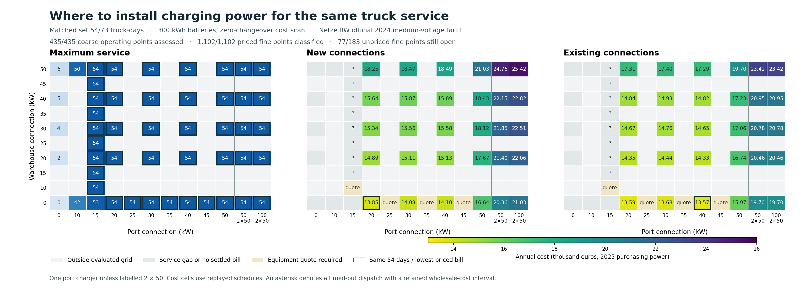

# 同一组车日的充电功率该放哪一站？ · Where should charging power go for the same truck service?

[中文](#中文) · [English](#english) · [精选结果 / Results](site_sizing.json) · [首页 / Home](../../README.md)

## 中文

**M8 六周规划期（2021-09-27 至 2021-11-07）内，20 kW 港区单站在本轮网格上即可保住同一组 54/73 个车日。** 港区降到 15 kW、仓库保持 0 时，只完成 53 个，遗漏 2021-10-29 的 3 号车；将仓库配至 10 kW 或提高港区功率均可补回。港区 10 kW 即便配仓库 50 kW 也最多完成 50 个，仓库单站最多完成 6 个。因此在规划期内，仅建一台港区充电机即可保留该组服务；在有报价且已回放的方案中，官方中压网费下最低年费对应新建接入 20/0 kW、既有接入 40/0 kW。[逐车日集合与放宽上限证据](site_sizing.json)

**第一折留出（2021-11-08 至 2021-12-19，随后 6 周）检验了三套事先固定的设施。** 双站基准（两站各 50 kW 充电机、100/75 kW 接入）从 63 个完整车日中登记 52 个；港区 20 kW 和 40 kW 单站各完成 51 个，港区即便增至 50 kW 仍漏掉 11 月 26 日的 1 号车。保持原港区额定功率并在仓库增加 15 kW 可恢复全部服务，最小有报价的仓库档为 20 kW。按预登记运行规则，两套有价修复（港/仓 20/20 kW 与 40/20 kW）在第一折 12 个计费口径下的同服务年费均低于双站基准。但这两套修复是在观察到第一折缺口后才确定的，不构成样本外验证；网费会影响费用排序，5 号车记录断点区间能否充电也会影响服务。[固定设施留出检验](holdout_test.md)

**第二折留出（2021-12-20 至 2022-02-06，随后 7 周）进一步否定了 12 周重新选出的最低年费方案。** 合并规划期与第一折共 12 周在有价粗网格上重选，12 个口径全部选出港区 40 kW 加仓库 20 kW（`F40`）或港/仓各 20 kW（`F20`）；将它们事先固定并登记规则后检验，在第二折分别少完成 1 个和 2 个登记车日。双站基准按自身可行服务登记 49/57 个车日，主情景下守住该集合是按构造成立的；行程耗电增加 10% 时，基准自己也少完成 1 个车日。两段留出各用于一次预定检验（第一折检验后并入 12 周选型样本，不再作为独立样本），数据已用完，本研究没有经样本外验证的推荐规模。设施固定后均按整周已知任务和电价离线排程（非在线策略）；规划期、第一折与第二折 DE-LU 日前均价分别为 €138.23、€206.16 和 €173.46/MWh，年费仅在同一时期内比较。[第二次留出检验](second_holdout.md) · [数据与电价](DATA.md)

**有价加密网格已补完，12 个计费口径的最低方案均保持原值。** 50 个硬件设计中有 42 个保留同一组车日。435 个粗网格运行点中，345 个有六周回放账单，90 个无法保留服务。每个有价加密点均已结算、判定不可行，或由年费下界证明不可能是最低。183 个缺价加密点中有 77 个尚无判定，缺价设备另报门槛。[账单、覆盖和证据清单](site_sizing.json)

| 有价加密点的判定 | 点数 |
|---|---:|
| 六周回放结算 | 120 |
| 求解证明不可行 | 13 |
| 由更宽松设施的不可行证明推出不可行 | 175 |
| 放松两站电量分配后仍送不进所需电量 | 24 |
| 放松网费后的年费下界排除 | 729 |
| 超时后的年费区间排除 | 38 |
| 已知峰值年费下界排除 | 3 |
| **合计** | **1,102** |

初筛将固定总电量在两站间自由分配，用可充电刻钟数约束峰值。最后 3 点和可能改变设备价位的点进一步使用已接受周的实测值。六周年账单取每站六个周峰值的最大值，因此已接受周的刻钟峰值给出年峰值下限。这些周按原排程固定分站电量，其余周放开分配。计算在电量端点和 2,500 满负荷小时分档两侧调用原计费规则。没有已接受周时沿用初筛下界。24 个容量不足点单列为不可行。在这些点，即使放开分站电量，仍无法送足维持运输服务所需的 58,387.79 kWh/年。两个下界均沿用相同的购电证明、年化和设备成本。[下界实现](../../src/um_charging/site_sizing_bounds.py) · [逐周回溯与判定](../../src/um_charging/site_sizing_known_peak_audit.py)

345 个粗网格结算点和 120 个有价加密结算点各留出一周，轮换六次。每次用其他记录的购电下界或最低小时价格估计留出周，固定其余五周的回放排程。33,480 次年费比较中，实际年费减下界的最小值为 €0.00001025，违反 0 次。硬件 `p1-20-w20` 限峰 15/20 kW、`p1-30-w0` 和 `p1-40-w0` 均限峰 15/0 kW 时，其下界在最接近最低方案的口径下仍高 €1,444.17、€488.87、€647.24/年。后两点缺少 10 月 25 日周的可行排程，年费仅有下界。三点均可据此排除，研究复算调用求解器 0 次。[精选结果](site_sizing.json)

### 保留同一组车日的设计

| 港区独立充电机数 | 港区接入 kW | 已核验的仓库接入 kW |
|---:|---:|---|
| 1 | 15 | 10、15、20、25、30、35、40、45、50 |
| 1 | 20 | 0、20、30、40、50 |
| 1 | 25 | 0 |
| 1 | 30 | 0、20、30、40、50 |
| 1 | 35 | 0 |
| 1 | 40 | 0、20、30、40、50 |
| 1 | 45 | 0 |
| 1 | 50 | 0、20、30、40、50 |
| 2 | 50 | 0、20、30、40、50 |
| 2 | 100 | 0、20、30、40、50 |

仓库单站在 0、20、30、40、50 kW 下的最大值依次为 0、2、4、5、6。港区单站的 10 与 15 kW 分别完成 42、53 个。对单机档，接入和设备额定功率同步变化，服务缺口归因到两者的联合上限。JSON 逐设计列出基准中少完成以及另选的车日，以及单独放宽港区或仓库后的恢复名单。[服务与归因](site_sizing.json)



### 年成本与基准差额

金额为 **€/年（2025 年购买力）**。电量费列合计日前购电费与按 kWh 计的网费。固定需量单价的单位为 2024 年 €/kW·年，电量部分仍按相应满负荷小时档结算。基准为原来的 100/75 kW 接入与两站各一台 50 kW，使用同样的运行峰值扫描。表内最低价均保留全部 54 个指定车日。[全部已核验设计的账单](site_sizing.json)

| 网费 | 接入口径 | 港/仓 kW | 充电机 | 接入 | 需量 | 电量费 | 合计 | 较基准 |
|---|---|---:|---:|---:|---:|---:|---:|---:|
| 无网费 | 新建 | 40/0 | 1,253.79 | 534.28 | 0.00 | 6,154.36 | **7,942.43** | −7,672.97 |
| 无网费 | 既有 | 40/0 | 1,253.79 | 0.00 | 0.00 | 6,154.36 | **7,408.15** | −5,869.77 |
| Frank 表 4 | 新建 | 20/0 | 764.03 | 267.14 | 4,258.43 | 8,367.71 | **13,657.30** | −8,521.80 |
| Frank 表 4 | 既有 | 20/0 | 764.03 | 0.00 | 4,258.43 | 8,367.71 | **13,390.16** | −6,451.45 |
| Netze BW 官方 | 新建 | 20/0 | 764.03 | 267.14 | 4,258.43 | 8,564.58 | **13,854.18** | −8,181.73 |
| Netze BW 官方 | 既有 | 40/0 | 1,253.79 | 0.00 | 931.47 | 11,380.60 | **13,565.86** | −6,132.57 |
| 固定需量 0 | 新建 | 20/0 | 764.03 | 267.14 | 0.00 | 8,367.71 | **9,398.87** | −8,732.11 |
| 固定需量 0 | 既有 | 20/0 | 764.03 | 0.00 | 0.00 | 8,367.71 | **9,131.73** | −6,661.76 |
| 固定需量 22.79 | 新建 | 20/0 | 764.03 | 267.14 | 465.73 | 8,367.71 | **9,864.61** | −8,732.11 |
| 固定需量 22.79 | 既有 | 20/0 | 764.03 | 0.00 | 465.73 | 8,367.71 | **9,597.47** | −6,661.76 |
| 固定需量 208.38 | 新建 | 20/0 | 764.03 | 267.14 | 4,258.43 | 8,367.71 | **13,657.30** | −8,732.11 |
| 固定需量 208.38 | 既有 | 20/0 | 764.03 | 0.00 | 4,258.43 | 8,367.71 | **13,390.16** | −6,661.76 |

| 网费 | 接入口径 | 充电机差额 | 接入差额 | 需量差额 | 电量费差额 |
|---|---|---:|---:|---:|---:|
| 无网费 | 新建 | −6,195.06 | −1,803.20 | 0.00 | +325.30 |
| 无网费 | 既有 | −6,195.06 | 0.00 | 0.00 | +325.30 |
| Frank 表 4 | 新建 | −6,684.83 | −2,070.34 | +3,094.09 | −2,860.72 |
| Frank 表 4 | 既有 | −6,684.83 | 0.00 | +3,094.09 | −2,860.72 |
| Netze BW 官方 | 新建 | −6,684.83 | −2,070.34 | +3,094.09 | −2,520.65 |
| Netze BW 官方 | 既有 | −6,195.06 | 0.00 | −232.87 | +295.36 |
| 固定需量 0 | 新建 | −6,684.83 | −2,070.34 | 0.00 | +23.06 |
| 固定需量 0 | 既有 | −6,684.83 | 0.00 | 0.00 | +23.06 |
| 固定需量 22.79 | 新建 | −6,684.83 | −2,070.34 | −0.00 | +23.06 |
| 固定需量 22.79 | 既有 | −6,684.83 | 0.00 | −0.00 | +23.06 |
| 固定需量 208.38 | 新建 | −6,684.83 | −2,070.34 | −0.00 | +23.06 |
| 固定需量 208.38 | 既有 | −6,684.83 | 0.00 | −0.00 | +23.06 |

20 kW 港区单站采用 20 kW 刻钟峰值。按官方网费，年满负荷小时超过 2,500 小时，进入高需量价、低电量价档。因此新建方案的需量项上升，设备、接入和电量三项合计仍产生净节约。40 kW 港区单站使用 40 kW 刻钟峰值，官方结算仍在低满负荷小时档。

10 套双港区机方案的有价粗网格账单均较贵。按同一网费和接入口径比较，最小的双机差额仍为 €5,493.83/年。[双机账单](site_sizing.json)

### 补算的粗网格点

港区 40 kW／仓库 20 kW 硬件下，两站的运行峰值都限 20 kW。六周独立回放保留原来的 54 个车日。2021-10-25 周的超时购电区间为 €186.583258 至 €186.596437（2021 年币值），宽 €0.013179，低于每周 €0.05 门槛。按通过回放的排程结算年费，单位为 2025 年 €/年。差额由补算点年费减去各情景原最低有价方案的年费。[周证据和年账单](site_sizing.json)

| 网费 | 新建年费 | 较原最低 | 既有年费 | 较原最低 |
|---|---:|---:|---:|---:|
| 无网费 | 10,452.69 | +2,510.26 | 9,651.27 | +2,243.12 |
| Frank 表 4 | 15,999.64 | +2,342.33 | 15,198.21 | +1,808.05 |
| Netze BW 官方 | 16,180.40 | +2,326.22 | 15,378.97 | +1,813.12 |
| 固定需量 0 | 11,275.47 | +1,876.60 | 10,474.05 | +1,342.32 |
| 固定需量 22.79 | 12,206.94 | +2,342.33 | 11,405.52 | +1,808.05 |
| 固定需量 208.38 | 19,792.33 | +6,135.03 | 18,990.91 | +5,600.74 |

### 设备报价改变选择的价位

官方网费下，其他价格固定，新建 20 kW 机的 2026 年未税设备价从 €4,445.38 升到 **€5,748.39** 时，30 kW 港区单站打平。既有 40 kW 机从 €7,295 升到 **€7,418.25** 时，20 kW 港区单站打平。若单独比较港区 HYC50，可分别改变原最低方案的设备报价或 HYC50 的年化整机成本。表内每格按新建／既有排列。三列各有 12 个精确门槛，金额显示到分。两处 HYC50 见证运行点的六周年费仍有宽度，但其下界均不足以改变打平价。[报价与年化输入](../day-ahead/connection_cost.json) · [门槛与证据](site_sizing.json)

| 网费 | 原机对任一替代的翻转价（€2026 未税） | 原机对 HYC50 的打平价（€2026 未税） | HYC50 保本年费（€2025/年） |
|---|---:|---:|---:|
| 无网费 | 8,521.84 / 9,299.00 | 20,728.66 / 19,951.50 | 1,415.58 / 1,549.15 |
| Frank 表 4 | 6,995.07 / 6,217.91 | 22,643.61 / 20,312.13 | 596.69 / 997.41 |
| Netze BW 官方 | 5,748.39 / 7,418.25 | 20,665.00 / 21,306.39 | 936.76 / 1,316.29 |
| 固定需量 0、22.79、208.38（到分相同） | 6,995.07 / 6,217.91 | 23,867.28 / 21,535.80 | 386.38 / 787.09 |

以下是官方网费下，尚缺标价的设备合计最多可承担的年费用（2025 年 €/年）。等于表中值时打平，低于时才节约。两个缺价档的行使用两台合计。183 个缺价加密点仍有部分未算，缺价设备门槛沿用已发布值，只覆盖已结算的运行点。[各网费和设备的门槛](site_sizing.json)

| 港/仓 kW | 缺价额定 kW | 对最低有价新建 | 对最低有价既有 | 对原基准新建 | 对原基准既有 |
|---|---|---:|---:|---:|---:|
| 15/10 | 10、15 | 232.47 | 278.07 | 8,414.20 | 6,410.64 |
| 25/0 | 25 | 622.65 | 668.25 | 8,804.38 | 6,800.82 |
| 35/0 | 35 | 967.28 | 1,146.45 | 9,149.01 | 7,279.02 |
| 45/0 | 45 | 992.04 | 1,304.78 | 9,173.77 | 7,437.35 |

### 模型与费用

样本沿用车队研究后六周，覆盖 2021 年 9 月 27 日至 11 月 5 日的 30 个日期。停靠记录给出停车时间上界。仓库放行 45 分钟、站点映射、允许插枪的窗口和两站独立计量均为 UM 情景设定。车辆为 S300（300 kWh 电池、30 kWh 储备、150 kWh 连续段首尾电量、50 kW 网侧上限、网侧到电池效率 90%）。边界 B 沿同车连续日结转电量，脱离完成集合的日子会断开连续段。六个求解周使用同期 DE-LU 原生小时日前价（Europe/Berlin，EUR/MWh），优化器已知该周所有任务与价格。[任务数据](DATA.md) · [跨日电量边界](energy_boundary.md) · [市场输入](../day-ahead/fleet_market.json)

硬件容量和运行峰值分开约束。站点连接容量与单台机的等效网侧功率按同一档设定。港区双机分别受 50 kW 单车上限和 50 或 100 kW 站点上限约束。对一套硬件，在每对不超硬件容量的刻钟峰值上限下求最低批发购电费，回放电表后选择账单最低的运行点。15 分钟平均上限允许送电不足一刻钟时瞬时功率高于运行峰值限值，瞬时功率仍受站点、设备和车辆的物理上限约束。每个计量点以最大刻钟平均功率和年用电量选择满负荷小时档。[网费输入](../day-ahead/network_charges.json) · [结算代码](../../src/um_charging/cabinet_tariff.py)

新建口径按所有接入 kW 计建设费。既有口径把原来的港区 100 kW、仓库 75 kW 接入视为沉没，只按增容计费，减容无退款。采用 Netze BW **2026 年中压**建设费 €172.74/kW（未税，含 19% 税为 €205.56/kW）。需求与电量网费沿用同运营商 **2024 年中压**价目。用 5% 折现、20 年寿命、零残值年化建设费。20 年是覆盖两轮 10 年充电机寿命的比较情景。接线、变压器和现场土建另计。样本按六周等权重复至 52 周。德国 CPI 将 2021 年日前价、2024 年网费和 2026 年资本输入分别乘以 121.9/103.1、121.9/119.3 和 121.9/126.5，统一为 2025 年购买力。126.5 是已公布的 2026 年 10 月德国综合 CPI。[成本输入及来源](../day-ahead/connection_cost.json) · [Netze BW 建设费](https://assets.cdn.netze-bw.de/xytfb1vrn7of/3WkwLb2wCAE2YcQuG0YU4m/cff72cf6af73c9b225d0268390f45ebf/preisuebersicht-baukostenzuschuss-bkz-strom.pdf) · [Destatis 2026 年 10 月 CPI](https://www.destatis.de/DE/Presse/Pressemitteilungen/2026/11/PD26_392_611.html)

充电机使用 Frank 等（2025）表 2 的 50 kW HYC50 文献设备价，以及 20、30、40 kW 的网店商品标价。20 kW 采用 WallboxCenter 的 €5,290 含税标价（型号 EMUC0204G1BC，厂商数据表和商家参数均为 20 kW DC）。30 和 40 kW 来自 J&S 的 €6,295、€7,295 未税标价。各档均采用设备价的 30% 安装费、每年 1% 维护费、10 年寿命和 5% 折现率。20 kW CCS2 壁挂机与 50 kW HYC50 属于不同设备等级。设备价格差还可能反映输入电制、计量、安装、保修及使用强度。标价是设备级市场证据，实际站点报价仍是缺口。对 10、15、25、35、45 kW 的未知价格，仅对可保留服务的设计报告年成本回本上限。[50 kW 基准](../day-ahead/connector_cost.json) · [20 kW 标价](https://wallboxcenter.de/shop/wallbox/dc-wallboxen/dc-wallbox-20kw-em2go-ultra-compact-inkl-5m-ccs-ladekabel-rfid-lanwlansim/) · [20 kW 数据表](https://wallboxcenter.de/wp-content/uploads/2026/02/DC-Wallbox-20kw-Ultra-Compact_Datenblatt.pdf) · [30 kW](https://jsenergystorage.de/PRODUKTE/30-kW-Gleichstrom-Ladestation-CCS2/) · [40 kW](https://jsenergystorage.de/PRODUKTE/40-kW-Gleichstrom-Ladestation-CCS2/)

先扫每站 0、20、30、40、50 kW，再以 5 kW 步长加密服务边界、最低有价点周边和港区单站区间，并检查 10、15 kW 档。双机港区的 100 kW 接入增加 60、70、80、90、100 kW 运行峰值。最大服务先证明完成数，再在并列完成数中尽量保留原来的 54 个车日。若较小设施已经达到上界且保留同一集合，扩大后沿用该服务证据。缺口逐车日列在 JSON。单独放宽港区、仓库的充电功率（关站则安装充电机）显示哪些车日可在相应最优排程中恢复。单机额定与站点容量同步变化时，归因对应两个上限的联合作用。[结果数据](site_sizing.json)

零换车扫描复用原跨日模型的整刻钟分组，只在同一原生价小时内合并可用车辆相同、每路均可同时供电、且没有跨站预约冲突的完整刻钟。内部事件用原子时段。五分钟复核继续逐枪模拟，按壁钟预约时相邻异车扣除空档。审计从展开排程独立重放物理插枪、停靠、分钟级站点和车辆功率、SOC、跨日电量、原生小时购电与两站刻钟计量，再用另一套算式核对年度网费。[零换车模型](../../src/um_charging/site_sizing.py) · [正换车模型](../../src/um_charging/fleet_changeover.py)

每次求解上限 300 秒。最大服务为整数最优证明。一般购电调度采用相对 gap ≤ 1e-6 或每周购电绝对 gap ≤ €0.01。超时如有通过回放的可行上界且周购电 gap ≤ €0.05，保留该购电区间。四项年成本按可行排程回放结算。年购电区间的换算系数是 52/6 × 121.9/103.1，故每个 €0.05 上限相当于约 €0.512（2025 年购买力）。区间只约束购电目标，需量和电量网费按回放排程的实测峰值与电量计算。原粗网格扫描的停止门槛为超过三组未判定或墙钟达到 90 分钟。

### 回归、需量对照与 5 分钟换车

基准单／双港区接口都完成原来的同一组 54 个车日，六周购电费复现为 **€568.854676／€530.674001**，通过 1e-6 容差。10 月 18 日周用新旧模型在额定峰值重算 34 个设计，完成集合逐组相同，电费最大差 €8.17e-13。按设备名义 20/20 kW 档留出一组后，重新求解原超时点（两站硬件各 50 kW、运行峰值各 20 kW），耗时 12.218 秒，其购电区间为 [€58.332821, €58.342811]。[回归和试跑](site_sizing.json)

在原基准硬件上，与 `cabinet_demand` 按相同目标对照，Frank 和官方账单差约 €0.005–0.006/年，50/0 kW 运行点已在网格内，差距来自逐周购电容差。固定 208.38 费率下，旧连续目标是区间，新旧可比目标差 €41.13–42.02/年，小于向上取到 20 kW 时的需量离散界 €365.44/年。固定费率的旧 P2 目标为购电加需量，其电量网费按解后分档。新扫描按网费档结算后选择运行点，所以在固定 0 和 22.79 费率下，账单可因跨档而下降。相同 P2 目标的下界对照通过。旧高费率结果的区间及全部对照见 JSON。[上一轮的连续峰值对照](cabinet_demand.md) · [本轮区间](site_sizing.json)

| 港/仓 kW | 5 分钟完成车日 | δ=0 六周购电 €2021 | δ=5 六周购电 €2021 | 年费用变化 €2025 |
|---|---:|---:|---:|---:|
| 20/0 | 同一组 54 | 758.377583 | 760.381986 | +20.54 |
| 40/0 | 同一组 54 | 600.600166 | 602.346357 | +17.89 |

5 分钟复核采用表内选出的运行上限，独立复算费用与分钟窗口，证明了原车日集合在正换车下仍可行。相比零换车，购电费用上升，以上两套设备足以维持原服务。[逐枪复核记录摘要](site_sizing.json)

### 复算与正式记录

从仓库根目录运行以下命令。实例用单车两个可用刻钟手算，13.5 kWh 行程能耗需 15 kWh 网侧电量。在仓库限 30 kW 时，港区 20 kW 不可行，港区 30 kW 可完成且购电 €2.25。试验命令应通过。绘图环境采用已有锁定的 Matplotlib 3.10.8 与 NumPy 2.3.5。[手算测试](../../tests/test_site_sizing.py) · [绘图版本](figures/plot_environment.json)

```powershell
$env:PYTHONPATH = 'src'
$testDir = Join-Path ([IO.Path]::GetTempPath()) ('um-site-sizing-' + [guid]::NewGuid().ToString('N'))
.\.venv\Scripts\python.exe -m pytest tests/test_site_sizing.py -q -p no:cacheprovider --basetemp $testDir
.\.venv\Scripts\python.exe -m um_charging.site_sizing
```

拥有离线记录的环境可从仓库根目录重现已知峰值判定和全部价位。程序从本机记录配置读取档案，将逐周检验、三个点的各口径年费区间和价位门槛写入一个新的临时目录。预期输出为 33,480 次年费检验、3 点排除、12 个网费与接入组合。

```powershell
$env:PYTHONPATH = 'src'
.\.venv\Scripts\python.exe -m um_charging.site_sizing_known_peak
```

粗网格的独立结算复核命令如下。输出应列出 345 个可比账单、90 个不可保留服务的点和 0 个缺口。官方网费最低年费为新建 €13,854.18 和既有 €13,565.86。

```powershell
$env:PYTHONPATH = (Join-Path (Get-Location).Path 'src')
$records = (Get-Content -LiteralPath '.um-records.local.json' -Raw -Encoding UTF8 | ConvertFrom-Json).records_root
$runArchive = Join-Path $records 'conversations\0001_records\runs\20261120_site_sizing'
$reviewFile = Join-Path ([IO.Path]::GetTempPath()) ('um-site-sizing-review-' + [guid]::NewGuid().ToString('N') + '.json')
.\.venv\Scripts\python.exe (Join-Path $runArchive 'tabulate_coarse_completion.py') --output $reviewFile
```

完整扫描入口在基准运行点评估 €568.854676 和 €530.674001。原正式扫描以干净提交 `0b6f616bb8033e6f19c4d48e21d85a0c46699674` 启动，至最后求解日志用时 5,395.48 秒。扫描按峰值组合和周分派求解。2021-10-04 周的分组排程在还原时因港区 5 号车有无预约正电量而中断。末轮账簿 1,171 条，合并去重后共 1,255 个周组，其中 1,221 个具有独立回放。原扫描汇总保留 23 条超时购电区间，最大周宽 €0.029912，超出 €0.05 门槛的周组为 0。汇总验证 762 组服务与 26,726 组购电单调性比较，并独立核对 2,118 份逐费率年账单。原始日志、求解、回放和实验启动器见离线库 `runs/20261120_site_sizing`。[原扫描记录](site_sizing.json)

粗网格补算从干净提交 `956cdaa88083c55de76f0d854be5c41e93295dcb` 启动，纳入分组回放的微量电量容差修复。仅重求 2021-10-04 和 2021-11-01，两周按原购电证明门槛通过，分别用时 24.788 秒和 0.031 秒。其余四周沿用同一模型、同一输入的离线解。两次求解沿用 300 秒单次上限，补算及审计墙钟 25.457 秒，六周排程逐份独立回放，完成六种网费结算复核，未判定周为 0。并入补算点后，共 26,934 组购电单调性比较通过。[补算来源哈希、周区间和日志定位](site_sizing.json)

## English

**During the six-week M8 planning period (27 September to 7 November 2021), a 20 kW port-only charger retained all 54 of 73 complete vehicle-days on this grid.** Reducing the port to 15 kW with zero warehouse capacity served 53 vehicle-days and missed vehicle 3 on 29 October 2021; adding 10 kW at the warehouse or raising the port rating restored that day. A 10 kW port paired with a 50 kW warehouse served at most 50 vehicle-days, and warehouse-only builds served at most six. One port charger therefore sufficed for the planning register, and among priced builds with replayed schedules under the official medium-voltage tariff, the lowest annual bills used 20/0 kW for new connections and 40/0 kW for existing access. [Service sets and capacity interventions](site_sizing.json)

**The first holdout (8 November to 19 December 2021, six weeks) tested three prespecified facilities.** The two-site baseline (one 50 kW charger per site on 100/75 kW connections) registered 52 of 63 complete vehicle-days. The 20 and 40 kW port-only facilities each served 51, and even a 50 kW port alone missed vehicle 1 on 26 November. Adding 15 kW at the warehouse restored service with either original port rating, with 20 kW as the smallest priced warehouse charger. Under the preregistered operating rule, both priced repairs (20/20 kW and 40/20 kW, port/warehouse) had lower annual bills than the baseline across all 12 first-holdout cases for the same service. Because the first-holdout shortfall guided those repairs, they do not constitute out-of-sample validation; network tariffs affect their cost order, and charging eligibility during vehicle 5’s recording gaps affects service. [Fixed-facility holdout](holdout_test.md)

**The second holdout (20 December 2021 to 6 February 2022, seven weeks) showed that the 12-week reselected least-cost designs also fell short.** Reselecting across the combined 12 weeks on the priced coarse grid yielded 40/20 kW (`F40`) or 20/20 kW (`F20`) across all 12 cases; when fixed in advance under preregistered rules, `F40` and `F20` missed one and two registered vehicle-days, respectively. The two-site baseline defined the 49/57 vehicle-day register from its own feasible service and therefore retained it by construction in the main scenario; with 10% higher driving energy, the baseline itself lost one vehicle-day. Each holdout was used once for its planned test (the first holdout was merged into the 12-week selection sample after its test and is no longer independent), all cohort weeks are exhausted, and the study has no sizing recommendation validated out of sample. Fixed-facility schedules use weekly full-information offline optimization rather than an online policy; mean DE-LU day-ahead prices were €138.23/MWh in planning, €206.16/MWh in the first holdout, and €173.46/MWh in the second holdout, so annual bills are compared only within the same period. [Second holdout](second_holdout.md) · [Data and prices](DATA.md)

**The priced refinement is complete. All twelve lowest-cost decisions and bills are unchanged.** Of the 50 builds, 42 retain the same service. All 435 coarse operating points have been assessed, with 345 six-week bills and 90 infeasible points. Every priced refined point has a settled bill, an infeasibility finding or an annual bill lower bound above the minimum. Of 183 unpriced refined points, 77 still lack a decision. [Coverage and evidence](site_sizing.json)

| Outcome on the priced refinement | Points |
|---|---:|
| Settled from six replayed schedules | 120 |
| Proved infeasible by the solver | 13 |
| Infeasible by comparison with a less restricted build | 175 |
| Insufficient energy delivery even with relaxed allocation | 24 |
| Excluded by the relaxed annual bill lower bound | 729 |
| Excluded by the annual bill interval after a timeout | 38 |
| Excluded by the annual bill lower bound with known peaks | 3 |
| **Total** | **1,102** |

Initial screening allowed the fixed energy to move between meters and bounded the peaks by the available charging quarters. For the last three points and the equipment thresholds, the annual peak at each meter is at least the highest quarter-hour peak in its accepted weeks. Keep the metered volumes of those weeks and allocate the remaining energy freely. The calculation uses the settlement function at the allocation endpoints and on either side of the 2,500-hour tariff boundary. A point with no accepted week retains its original bound. The 24 capacity failures cannot deliver the required 58,387.79 kWh/year even with relaxed meter allocation. Both methods use the same wholesale proofs, capital costs and annualization. [Network bounds](../../src/um_charging/site_sizing_bounds.py) · [Holdout and classification](../../src/um_charging/site_sizing_known_peak_audit.py)

Leaving out each week at 345 coarse and 120 priced refined settlements gave 33,480 annual comparisons and zero violations. The smallest actual bill less its bound was €0.00001025. Each holdout used an independent wholesale bound or the lowest hourly price and kept the other five audited schedules. The closest annual margins above a winning bill were €1,444.17 for `p1-20-w20` at 15/20 kW, €488.87 for `p1-30-w0` at 15/0 kW and €647.24 for `p1-40-w0` at 15/0 kW. The latter two have no feasible archived schedule for the week of 25 October, so only their lower bills are available. The archive calculation used zero solver calls. [Results and reproduction command](#复算与正式记录)

### Annual costs

The official Netze BW tariff gives 20/0 kW for new connections and 40/0 kW for existing connections among the priced, assessed options. Amounts below are annual euros in 2025 purchasing power. Energy includes wholesale purchases and network usage charges per kWh. The legacy benchmark uses 100/75 kW connections and one 50 kW charger at each site. Both cases use the same eligible tasks, the same selected 54 truck-days, and the same operating scan. [Design bills and four-component changes](site_sizing.json)

| Network case | Connections | Port/warehouse kW | Chargers | Connection | Demand | Energy | Total | Change vs legacy |
|---|---|---:|---:|---:|---:|---:|---:|---:|
| No network charge | New | 40/0 | 1,253.79 | 534.28 | 0.00 | 6,154.36 | **7,942.43** | −7,672.97 |
| No network charge | Existing | 40/0 | 1,253.79 | 0.00 | 0.00 | 6,154.36 | **7,408.15** | −5,869.77 |
| Frank Table 4 | New | 20/0 | 764.03 | 267.14 | 4,258.43 | 8,367.71 | **13,657.30** | −8,521.80 |
| Frank Table 4 | Existing | 20/0 | 764.03 | 0.00 | 4,258.43 | 8,367.71 | **13,390.16** | −6,451.45 |
| Netze BW official | New | 20/0 | 764.03 | 267.14 | 4,258.43 | 8,564.58 | **13,854.18** | −8,181.73 |
| Netze BW official | Existing | 40/0 | 1,253.79 | 0.00 | 931.47 | 11,380.60 | **13,565.86** | −6,132.57 |
| Fixed demand 0 | New | 20/0 | 764.03 | 267.14 | 0.00 | 8,367.71 | **9,398.87** | −8,732.11 |
| Fixed demand 0 | Existing | 20/0 | 764.03 | 0.00 | 0.00 | 8,367.71 | **9,131.73** | −6,661.76 |
| Fixed demand 22.79 | New | 20/0 | 764.03 | 267.14 | 465.73 | 8,367.71 | **9,864.61** | −8,732.11 |
| Fixed demand 22.79 | Existing | 20/0 | 764.03 | 0.00 | 465.73 | 8,367.71 | **9,597.47** | −6,661.76 |
| Fixed demand 208.38 | New | 20/0 | 764.03 | 267.14 | 4,258.43 | 8,367.71 | **13,657.30** | −8,732.11 |
| Fixed demand 208.38 | Existing | 20/0 | 764.03 | 0.00 | 4,258.43 | 8,367.71 | **13,390.16** | −6,661.76 |

The 20 kW new-site option reaches the high-utilization band under the official tariff. Its demand charge rises and the network charge per kWh falls. The existing-site 40 kW option remains in the low-utilization band. Under that tariff, the 30 kW port build ties the 20 kW new-site build at a net 20 kW equipment price of €5,748.39. The 20 kW build ties the existing-site 40 kW build at a net 40 kW equipment price of €7,418.25. [Crossovers](site_sizing.json)

Each cell below gives new / existing connections. All 36 thresholds are exact within the priced grid and billing policy, shown to cents. Both HYC50 comparison points retain annual bill intervals, whose lower ends cannot move the crossover. For unpriced equipment, published ceilings cover previously settled points only. At the assessed 15/10 kW two-site build, the combined equipment ceiling is €232.47/year for new capacity and €278.07/year for existing capacity under the official tariff. The 183 unpriced refined points have partial coverage. [All equipment ceilings](site_sizing.json)

| Network case | Incumbent vs any alternative (€2026 net) | Incumbent vs HYC50 (€2026 net) | HYC50 break-even annual cost (€2025/year) |
|---|---:|---:|---:|
| No network charge | 8,521.84 / 9,299.00 | 20,728.66 / 19,951.50 | 1,415.58 / 1,549.15 |
| Frank Table 4 | 6,995.07 / 6,217.91 | 22,643.61 / 20,312.13 | 596.69 / 997.41 |
| Netze BW official | 5,748.39 / 7,418.25 | 20,665.00 / 21,306.39 | 936.76 / 1,316.29 |
| Fixed demand 0, 22.79, 208.38 (equal to cents) | 6,995.07 / 6,217.91 | 23,867.28 / 21,535.80 | 386.38 / 787.09 |

### Final coarse operating point

The 40 kW port and 20 kW warehouse build uses 20 kW operating caps at both sites. Independent replay retains the same 54 truck-days. The 25 October 2021 solve timed out with a wholesale cost interval of €186.583258 to €186.596437 in 2021 euros. Its €0.013179 width is below the €0.05 weekly limit. The feasible replays determine the bills below, in annual euros at 2025 purchasing power. Each difference is relative to the previous lowest priced option for that case. [Weekly evidence and annual bills](site_sizing.json)

| Network case | New annual bill | Difference | Existing annual bill | Difference |
|---|---:|---:|---:|---:|
| No network charge | 10,452.69 | +2,510.26 | 9,651.27 | +2,243.12 |
| Frank Table 4 | 15,999.64 | +2,342.33 | 15,198.21 | +1,808.05 |
| Netze BW official | 16,180.40 | +2,326.22 | 15,378.97 | +1,813.12 |
| Fixed demand 0 | 11,275.47 | +1,876.60 | 10,474.05 | +1,342.32 |
| Fixed demand 22.79 | 12,206.94 | +2,342.33 | 11,405.52 | +1,808.05 |
| Fixed demand 208.38 | 19,792.33 | +6,135.03 | 18,990.91 | +5,600.74 |

### Assumptions and settlement

The six fleet weeks cover 30 dates from 27 September to 5 November 2021 and use S300 (300 kWh battery, 30 kWh reserve, 150 kWh at both ends of each continuous spell, 50 kW grid draw per truck, and 90% grid-to-battery efficiency). Boundary B carries state of charge across linked, completed days. Travel timestamps bound dwell, while the site mapping, 45-minute warehouse release and eligible charge windows follow the UM scenario. The optimizer knows the full week's tasks and the contemporaneous native hourly DE-LU day-ahead prices in Europe/Berlin (EUR/MWh). [Fleet data](DATA.md) · [Energy boundary](energy_boundary.md) · [Market input](../day-ahead/fleet_market.json)

Each installed rating limits instantaneous power. Software caps each meter's aligned quarter-hour mean independently, including the idle portion of partial quarters. At each pair of scan caps, the model minimizes wholesale purchases. The annual comparison takes the cheapest complete invoice after replaying both meters and applying the appropriate utilization bands. A dual port build uses two separate 50 kW units. [Network tariff](../day-ahead/network_charges.json) · [Settlement](../../src/um_charging/cabinet_tariff.py)

New connections pay Netze BW's 2026 net medium-voltage construction contribution of €172.74/kW (gross €205.56/kW, 19% VAT). The existing-site case treats its 100/75 kW connections as sunk, bills only increments and pays no refund for downsizing. The modeled one-time charge has a 20-year economic life and 5% discount rate, spanning two 10-year charger lives. Exclude site-specific connection lines, transformers and civil works. Netze BW's medium-voltage usage tariff is from 2024. Repeat all six weeks equally over 52 weeks. Express wholesale electricity, usage tariffs and capital quotes in 2025 purchasing power using German CPI, with indices 103.1 (2021), 119.3 (2024), 121.9 (2025) and 126.5 (October 2026). [Capital data](../day-ahead/connection_cost.json) · [Netze BW price sheet](https://assets.cdn.netze-bw.de/xytfb1vrn7of/3WkwLb2wCAE2YcQuG0YU4m/cff72cf6af73c9b225d0268390f45ebf/preisuebersicht-baukostenzuschuss-bkz-strom.pdf) · [Destatis CPI](https://www.destatis.de/DE/Presse/Pressemitteilungen/2026/11/PD26_392_611.html)

Frank et al. Table 2 supplies the 50 kW Alpitronic HYC50 benchmark. The 20 kW WallboxCenter listing identifies the EM2GO Ultra Compact DC wallbox, SKU EMUC0204G1BC, in agreement with the manufacturer's datasheet. The 30 and 40 kW J&S figures are also online equipment listings. All ratings use 30% installation, 1% annual maintenance on equipment value, 10-year life and 5% discounting. Lower-power wallboxes and the HYC50 represent different equipment classes. Installation, AC input, metering, service and warranty may differ in procurement. The retail prices support a scenario, with thresholds for the prices needed to change the choice. [50 kW benchmark](../day-ahead/connector_cost.json) · [20 kW product](https://wallboxcenter.de/shop/wallbox/dc-wallboxen/dc-wallbox-20kw-em2go-ultra-compact-inkl-5m-ccs-ladekabel-rfid-lanwlansim/) · [20 kW datasheet](https://wallboxcenter.de/wp-content/uploads/2026/02/DC-Wallbox-20kw-Ultra-Compact_Datenblatt.pdf) · [30 kW](https://jsenergystorage.de/PRODUKTE/30-kW-Gleichstrom-Ladestation-CCS2/) · [40 kW](https://jsenergystorage.de/PRODUKTE/40-kW-Gleichstrom-Ladestation-CCS2/)

The coarse site grid uses 0, 20, 30, 40 and 50 kW. Refinement adds 5 kW steps around service crossings and priced minima, including 10 and 15 kW where needed. For dual port plugs on a 100 kW connection, operating caps also include 60, 70, 80, 90 and 100 kW. Given a physical maximum, the service solve maximizes overlap with the registered set. The JSON lists missing and added duties and reports what a one-site capacity relaxation restores in each certified witness. For a single charger, its power and the site connection are varied together. [Results](site_sizing.json)

At zero changeover time, interchangeable whole quarters within one native-price hour can be pooled. The model retains atomic intervals for internal events, shared-feed contention and cross-site reservations. Five-minute verification uses named plugs. Independent replay reconstructs physical availability, minute-level limits, SOC across linked days, hourly purchases and the quarter-hour meter maxima, and separately recalculates both annual invoices. The 300-second solve budget uses integer service certificates and a relative wholesale gap of 1e-6 or a weekly absolute gap of €0.01. A timed-out dispatch with an audited upper bound and a weekly gap at most €0.05 may be reported as a wholesale interval. The feasible replay determines the billed peaks and volume charges. The original coarse scan had a stop rule of more than three unresolved groups or 90 minutes. [Zero-delay model](../../src/um_charging/site_sizing.py) · [Named plugs](../../src/um_charging/fleet_changeover.py)

### Verification

The single- and two-port-plug references reproduce €568.854676 and €530.674001 for the same 54 days. The week of 18 October gives identical duty sets across the two formulations in 34 rated-build comparisons, with maximum wholesale difference €8.17e-13. The retry of the 20/20 kW operating point on 50/50 kW hardware met the weekly tolerance in 12.218 seconds. For the earlier continuous-peak study, the comparable Frank and official bill differences are €0.005–0.006/year, within the weekly wholesale tolerances. The high fixed-rate comparison is within its grid rounding allowance. The lower fixed-rate bills reflect interval meter utilization bands on a different scheduling policy.

In the physical five-minute replay, both 20/0 and 40/0 kW retain the exact same 54 truck-days. Wholesale purchases increase from €758.377583 to €760.381986 and from €600.600166 to €602.346357 over the sample, respectively. The annual increases are €20.54 and €17.89. The original formal scan started from clean commit `0b6f616bb8033e6f19c4d48e21d85a0c46699674`. Its final solver log was 5,395.48 seconds after the start. Schedule reconstruction raised an error on a positive energy entry without a port reservation for vehicle 5 in the week of 4 October 2021. The JSON records the original scan's 23 retained timeout intervals. [Original scan records](site_sizing.json)

The final coarse point used clean commit `956cdaa88083c55de76f0d854be5c41e93295dcb`, which includes the numerical tolerance fix for grouped schedule replay. The solves for 4 October and 1 November met the original wholesale gap tolerances in 24.788 and 0.031 seconds, respectively, under the 300-second per-solve limit. The other four weeks used archived results from the same model and inputs. The supplement took 25.457 seconds of wall time including independent replay of all six weeks and a settlement check for each of the six tariffs. All six weeks met the acceptance rules. With the added point, 26,934 wholesale cost monotonicity comparisons passed. [Reproduction from the repository root](#复算与正式记录) · [Supplement hashes, bounds and evidence paths](site_sizing.json)
